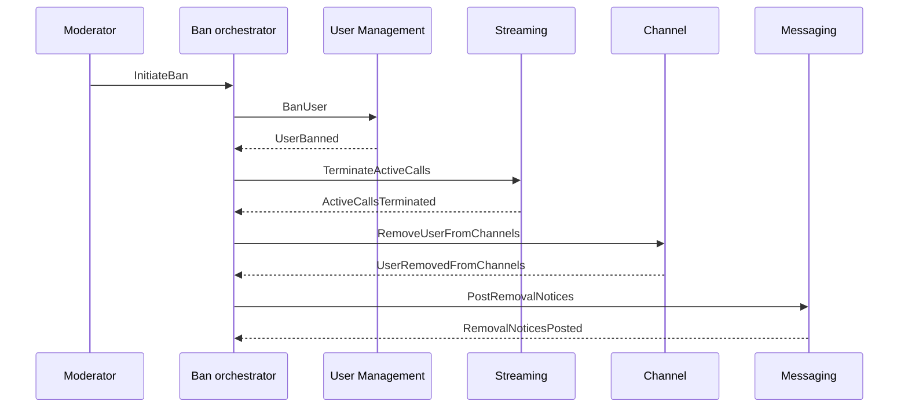
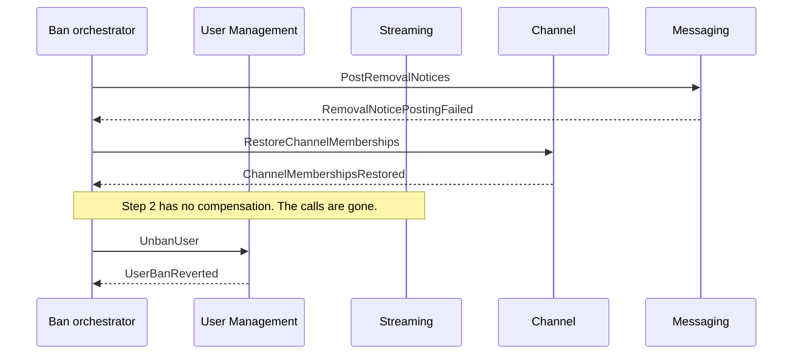

# Saga: a user is banned

Banning a user touches four services. Each of them owns data the others cannot write, so there is no transaction that covers all four. This document describes the workflow as a saga: a sequence of local transactions, each with a compensating action that undoes it if a later step fails.

## Participants

One row per participant. "Owns" is the data that service is the source of truth for, and no other service may write it.

| Service | Owns | Its step in this saga |
| --- | --- | --- |
| User Management | Users, sessions | Mark the user banned and invalidate active sessions |
| Streaming | Voice and video calls | Terminate the user's active calls |
| Channel | Channels, memberships | Remove the user from every channel they belong to |
| Messaging | Messages | Post a system message in each affected channel |

## Order of the steps

The ban comes first, so the user stops being able to act while the rest runs. Calls are terminated next, because an open microphone is the most immediate problem. Membership cleanup and the system messages follow, because they change what others see rather than what the banned user can do.

This differs from the order the scenario lists, where the channel step comes before the streaming step. The scenario's own wording asks for calls to be terminated immediately, and that is the reason for the change.

## The steps

One row per step. "Started by" is the command that begins it, "Success" and "Failure" are the events the participant emits, and "Compensation" is what undoes the step if a **later** step fails.

| # | Service | Started by | Success | Failure | Compensation |
| --- | --- | --- | --- | --- | --- |
| 1 | User Management | `BanUser` | `UserBanned` | `UserBanFailed` | `UnbanUser` → `UserBanReverted` |
| 2 | Streaming | `TerminateActiveCalls` | `ActiveCallsTerminated` | `CallTerminationFailed` | None possible |
| 3 | Channel | `RemoveUserFromChannels` | `UserRemovedFromChannels` | `ChannelRemovalFailed` | `RestoreChannelMemberships` → `ChannelMembershipsRestored` |
| 4 | Messaging | `PostRemovalNotices` | `RemovalNoticesPosted` | `RemovalNoticePostingFailed` | None needed |

Two steps have no compensating action, and the reasons are different. Step 2 has none that is possible: a terminated call cannot be restored. Step 4 has none that is needed: it is the last step, so nothing after it can fail and it is never rolled back. Only the first of the two leaves the system in a state the saga is unable to undo.

## Happy path

## Failure paths

One row per failing step. "Compensates" lists the steps the orchestrator rolls back, in reverse order.

| Fails | Compensates | Note |
| --- | --- | --- |
| 1 | Nothing | No step has completed. The saga ends as failed |
| 2 | 1 | The user is unbanned |
| 3 | 2, 1 | The calls cannot be restored. The orchestrator records that the compensation was impossible |
| 4 | 3, 2, 1 | Memberships are restored, the calls are still gone, the user is unbanned |

The worst case, where the last step fails:

## What cannot be undone

A terminated call cannot be restored. Streaming can give the user access again, but the conversation the other participants were in is over, and nothing puts them back in it.

The orchestrator does not pretend otherwise. It records that the compensation for step 2 was impossible and leaves the saga in a state that says so: rolled back, but not to the state it started in. Someone has to be told, and that is an operator's job rather than something the system can resolve on its own.

Something similar would apply to the system messages in step 4 if the workflow were ever extended with a step after it. They could be deleted, but members who were online have already read them.

## What is implemented in this repository

Channel Service is the only service that exists, so part of the saga is real and part of it is not.

The orchestrator is real. It runs inside Channel Service, subscribes to every message in the saga, keeps its state in a store of its own, and sends the commands and compensating commands described above.

Channel Service's own step is real. One handler removes the user from every channel they belong to and records what it removed; another puts those memberships back with the role each one had. Both publish their result on the broker, and the orchestrator picks it up there, so step 3 runs over RabbitMQ from end to end.

User Management, Streaming and Messaging do not exist. The commands addressed to them are published and nothing consumes them. In the tests, the test code plays those services: it sends the events they would have sent, and that is what drives the saga forward, or backwards in the failure cases.

What is therefore not demonstrated is a real distributed failure. The failures in the tests are events a test chose to send, not a service that actually broke.

## Why orchestration

The flow is coordinated by one orchestrator that receives every message in the saga and decides what happens next, rather than by each service reacting to the previous one.

The reason is that someone has to decide that the saga has failed. In choreography there is no such party: each service reacts to the event in front of it, and the knowledge of how far the workflow got is spread across four services that each know only their own part. Rolling back three steps in reverse order, and recording that one of them could not be rolled back, requires a single place that knows the whole sequence.

What would be harder with choreography is precisely that rollback. Each service would have to listen for the failure events of every other service and work out from them whether its own step needs undoing, which means every service ends up knowing the shape of the whole workflow anyway — with the coupling spread out instead of removed.

What orchestration costs is coupling in one place. The orchestrator knows about bans, calls, memberships and messages, and it is a single point of failure for the workflow. In a system with many sagas, that is also where complexity accumulates.

## Where the saga state lives

In two places, and the split matters.

**The orchestrator** stores how far the saga has come: the saga id, the user, a flag per completed step, and whether the saga is completed, failed or rolled back. This is what answers "which steps need undoing". It lives with the orchestrator because it is the only party that knows the sequence.

**Each participant** stores its own undo data. Channel Service records which channels it removed the user from and with which role in each, keyed by saga id. The orchestrator never sees that: it sends `RestoreChannelMemberships` with a saga id, and the participant looks up what it did.

Putting the channel ids and roles in the orchestrator's state would mean a service that does not own memberships holds them anyway, which is the coupling the service boundaries exist to prevent.

## Where the orchestrator should live

In this repository the orchestrator is part of Channel Service, because Channel Service is the only service that exists. That is not where it belongs. A ban is User Management's business, and the orchestrator would sit there, or in a moderation service of its own.

It is kept in its own folder, separate from the channel domain code, so that the separation is visible and the move would be mechanical.

## A note on the pattern itself

A saga rolls a workflow backwards when a step fails. For a ban, that is arguably the wrong instinct. If the calls cannot be terminated, the right answer is probably to keep trying rather than to unban a user a moderator decided to remove — forward recovery rather than backward.

The workflow is modelled as a saga here because that is what the assignment asks for, and because Channel Service's own step is genuinely reversible, which makes the pattern possible to demonstrate. In a real system the ban itself would most likely be treated as a decision that stands, with the remaining steps retried until they succeed.